<h1 align="left">Портфолио</h1>

<p1 align="left">Разработчик. Умею писать поддерживаемый код, работать с базами данных и git. Самостоятельно изучаю новые технологии. По минимуму эксплуатирую ИИ, чаще всего для разъяснения для себя некоторых непонятных моментов.
Хочу применить свои знания на реальных проектах, создавать нужные и безопасные проекты.

Почему я:

- Чистый код: Использую строгую типизацию, пишу понятные комментарии и документацию.

- Современный стек: Не пишу на устаревших синхронных библиотеках. Только async/await.

🧑‍💻Реализованнные проекты:

1.Mini GitHub — платформа совместной разработки.

[Стек: Python, Django, PostgreSQL, Redis, Celery, Docker]

2.TODOst — приложение для управления задачами с:
- Работой с досками 
- Колонками 
- Задачами

[Стек: Python, FastAPI, PostgreSQL, Docker Compose, React 18 + TypeScript]

<h3 align="left">🛠Основные инструменты разработки:</h3>

  
  
  
  
  
  
  
  
  

<h2 align="center">Языки:<h2>

Русский — родной Английский — В2

  

